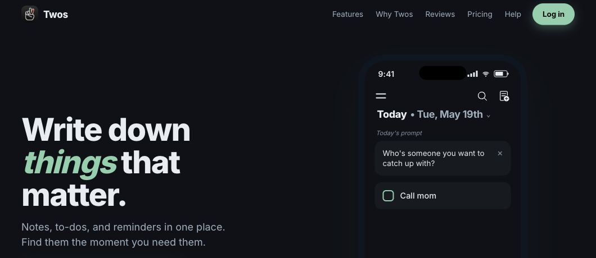
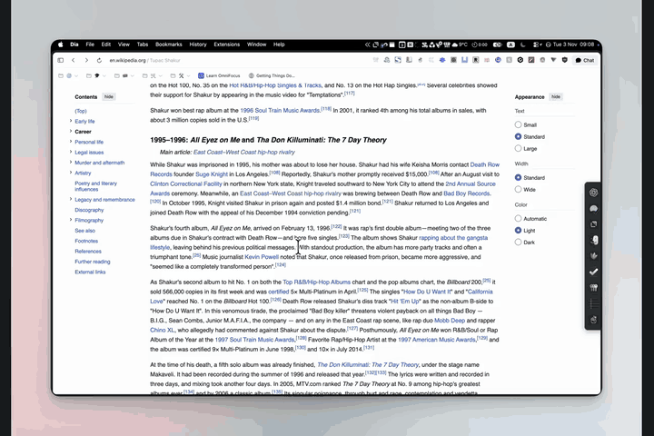

# Twos for PopClip



Capture selected text to Today or another existing list in [Twos](https://www.twosapp.com/) (previously NewTwos).

Choose **Today**, or choose **Other…** in the extension settings and enter a list name or ID. Click the **Twos logo** in PopClip to save the selection as one thing. The saved destination applies to future captures.

Choose a **Default thing type**: Dash, To-do, Bullet, Number, Note, or Sublist. **Sublist** creates a new nested list named from the selection. Optionally enter a **Default tag**, such as `reading`; the extension appends `#reading` automatically.



[Watch the MP4 version](source/Twos.popclipext/demo.mp4).

Requires **PopClip 2026.8.1 (build 6221) or later**, internet access, and a Twos personal API key with **write:things** permission. **Sublist** also requires **write:lists**. No additional executable or running Twos app is needed.

## Install

Open `source/Twos.popclipext` with PopClip, approve the unsigned source extension, and enter your API key in the extension settings.

See the [extension readme](source/Twos.popclipext/README.md) for full setup, destination behavior, data handling, and troubleshooting.

## Directory submission

Source repository: [ma-burke/twos-popclip](https://github.com/ma-burke/twos-popclip).

Initial release: **v1.0.0**. The PopClip Directory app is installed for this repository. The repository owner approved its access and the submission agreement on 3 November 2026. The tagged commit's **Submission Check** and directory-app comment are the authoritative submission status; directory publication requires human review.

The [listing review](LISTING-REVIEW.md) records the guideline audit and the remaining app-distribution question.

The [submission guide](SUBMISSION.md) follows [PopClip's official submission process](https://www.popclip.app/extensions/submit). The submission is the readable `source/Twos.popclipext` directory, not a zipped installer.

## Development and validation

Run the local checks from this repository's root:

```sh
node tests/verify.mjs
```

Node.js is needed only for these development checks, not for using the extension. The checks use simulated API responses and do not contact Twos or modify an account.

Verified locally: 78 simulated capture scenarios covering destinations, all six types, tag normalization, duplicates, sublist creation and partial failures, text preservation, API errors, metadata, and package limits. The maintainer reported a successful live test of the original capture behavior on 3 November 2026. The new type, tag, and sublist options in 1.1.0 have been checked with simulated API responses; a live PopClip test of those new options remains outstanding.

The extension uses PopClip's bundled Axios library to send one request to the [Twos API](https://www.twosapp.com/api/v1/openapi.json) for ordinary captures, or two for creating and linking a new sublist. No API key is included in this repository.

## License and attribution

[MIT](LICENSE). Independent extension; not an official Twos or PopClip product. The PopClip directory credits the owner of the submitting GitHub repository automatically.

Banner screenshot: [Twos public website](https://www.twosapp.com/), © Twos Technologies Inc. The MIT license applies to this extension's code.

Toolbar icon: official monochrome Twos artwork from the desktop app, adapted with a transparent background and proportional padding. Twos logo © Twos Technologies Inc.
