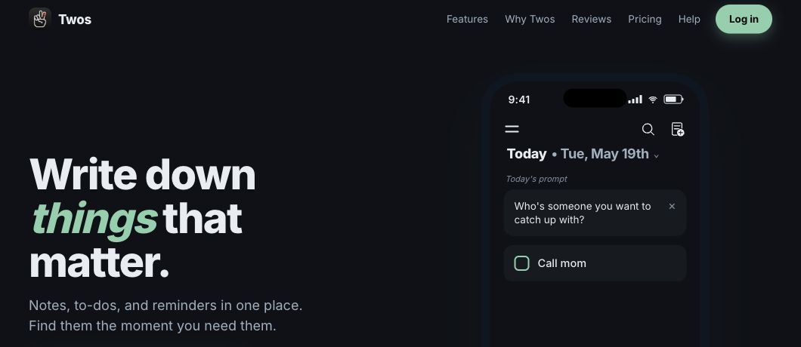

# Twos for PopClip

Save selected text to Today or another existing Twos list with one click.

## Demo

[Watch the 10-second demo](demo.mp4): select text, click **Add to Twos** in PopClip, and see it appear on Today.

## Install and configure

1. Use PopClip 2026.8.1 (build 6221) or later.
2. Open the **Twos.popclipext** package or a **Twos.popclipextz** installer with PopClip and approve installation. Source packages are unsigned; the PopClip directory signs extensions after review.
3. In [Twos → Settings → API Keys](https://www.twosapp.com/settings/api-keys), create a personal API key with **write:things** permission. No read or list-management permission is needed by this extension.
4. In PopClip's extension settings for **Twos**, paste the key into **API key**. PopClip stores this secret in this Mac's Keychain; the key is not embedded in the extension.
5. Set **Add to list** to **Today**, or choose **Other…** and enter an existing list's exact name or 24-character list ID. An ID is useful if several lists have the same name. This is a saved destination field, not a live dropdown of all your Twos lists.

## Use

Select text in any app where PopClip works, then click the **2s** button (tooltip: **Add to Twos**). A check mark means the API returned a created item. Open Twos to see it.

- Today is resolved by Twos when you click, in your account's timezone. It is not fixed to the installation date and does not follow the list currently open in Twos.
- Other destinations can be a list name, list ID, `tomorrow`, `yesterday`, or a date such as `2026-11-10`.
- Each click creates one thing, including for a selection containing line breaks. Your Twos default thing type is used.
- The extension sends the full selected text without trimming it or appending a source URL. Twos may interpret Markdown within that text; original rich text styling is not captured.
- Internet access is required. Twos does not need to be running.
- To change the destination or API key later, open this extension's settings in PopClip.

## If it fails

A missing/invalid key, missing permission, or rejected list opens extension settings. Confirm the **write:things** permission and destination spelling; use the list ID for duplicate names. Other errors show PopClip's failure indicator. If a connection times out or a server response is unexpected, check the destination in Twos before clicking again: the save may already have happened. The extension does not retry automatically or queue offline captures.

The key and selected text are sent only to `https://www.twosapp.com/api/v1/things` over HTTPS. There is no analytics or helper service.

## Source

`Config.json` defines the settings and action. `add.js` performs one API request. There are no external executables to install; Axios is supplied by PopClip. This extension is provided under the included MIT license and is not an official Twos or PopClip extension.

Banner: cropped from the [Twos public website](https://www.twosapp.com/), 3 November 2026. Website design and screenshot © Twos Technologies Inc.; the MIT license applies to this extension's code.

## Changelog

- 1.0.2 (2026-11-03): Added a silent video demonstrating capture to Today. Extension behavior is unchanged.
- 1.0.1 (2026-11-03): Added a documentation banner showing the Twos website and Today preview. Extension behavior is unchanged.
- 1.0.0 (2026-11-03): Initial release, with capture to Today or a saved list name or ID.
